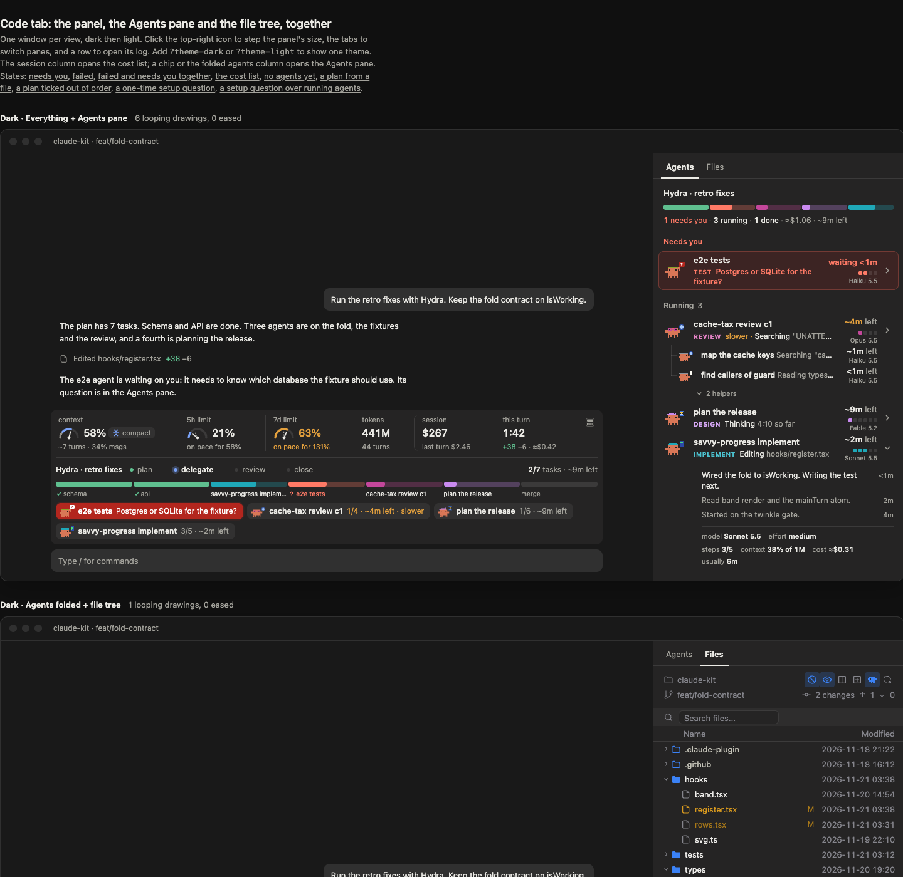

# clawpit

An instrument panel above the prompt and a crew pane beside it, for the Claude Code desktop app.

- **The panel** shows what matters right now: context left and when it auto-compacts, the 5-hour and 7-day limits against pace, this turn's clock, lines changed and cost, the session's cost and tokens, tests, and the Hydra plan's phase and tasks. Columns appear only when they have something to say and fit the width.
- **The Agents pane** is a roster of every subagent and crew: who needs you, who is running, who has ended. Each one is a pixel crab holding the tool it's using, with time left, its steps, and a log that opens with a click.
- **One-time setup:** a clawpit or savvy-progress setting whose /config value is still "unasked" is asked once, directly under the Agents pane's head, with Yes and No. The answer is saved as if picked in /config, where it can be changed any time; the question waits while anything needs you or has failed. A write that is refused is not asked again.
- **Three sizes**, switched by one icon: everything, agents folded, or one line.
- **Calm by rule:** nothing moves while idle, motion uses stepped loops only, and colours are fixed and contrast-checked in light and dark.

The ETA is kept per stage list: a word added to or removed from savvy's stages starts a new ETA key and leaves the old one in the store (nothing prunes `eta:` keys).

> **Status:** in development, not released. The preview below is the design mockup.

<!-- preview: refreshed after every visual change, see AGENTS.md -->
<picture>
  <source media="(prefers-color-scheme: light)" srcset="design/preview-light.png">
  
</picture>

## Install

```
/plugin marketplace add nycom/clawpit
/plugin install clawpit@clawpit
```

clawpit needs savvy-progress installed: it reads savvy's crew data, and savvy's own band stands down while clawpit runs on the desktop.

Use savvy-progress from nycom/claude-kit main once its clawpit change has merged (nycom/claude-kit#9): it carries the step `reason` and `error` fields clawpit reads, and stands its band down on the desktop. Update savvy-progress first, then install or update clawpit.

## How it is tested

Unit tests run under the engine's mock (`claude plugin test plugin`). Playwright stills and motion counts run on a render harness (`npm run test:visual`). The helper scripts have their own tests (`npm run test:scripts`). In-app checks capture the app window and diff it pixel by pixel (`scripts/app-capture.sh`, `npm run app-diff`); the screenshots stay out of the repo.

## Docs

- [`AGENTS.md`](AGENTS.md): the rules for working in this repo. Read it before changing anything.
- [`docs/decisions/`](docs/decisions/): the locked design decisions, the animation budget, and the file tree decision.
- [`docs/plans/`](docs/plans/): build plans.
- [`design/`](design/): the interactive mockup. Open `design/mockups-all.html` in a browser; add `?theme=dark` or `?theme=light`.

## Licence

MIT
